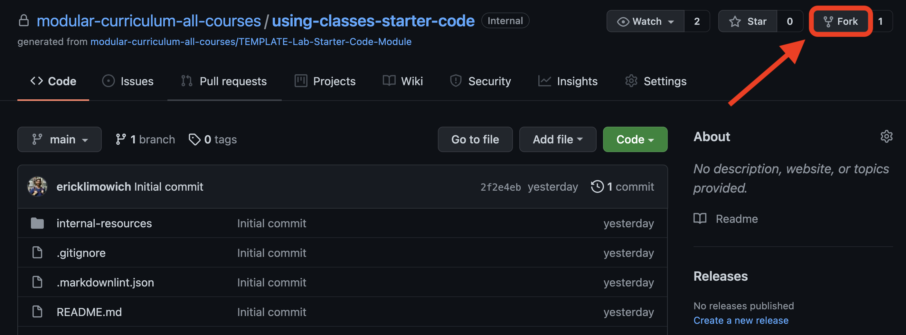
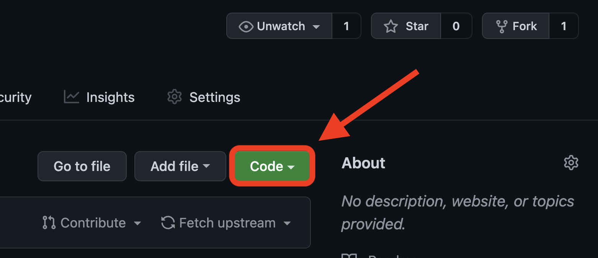
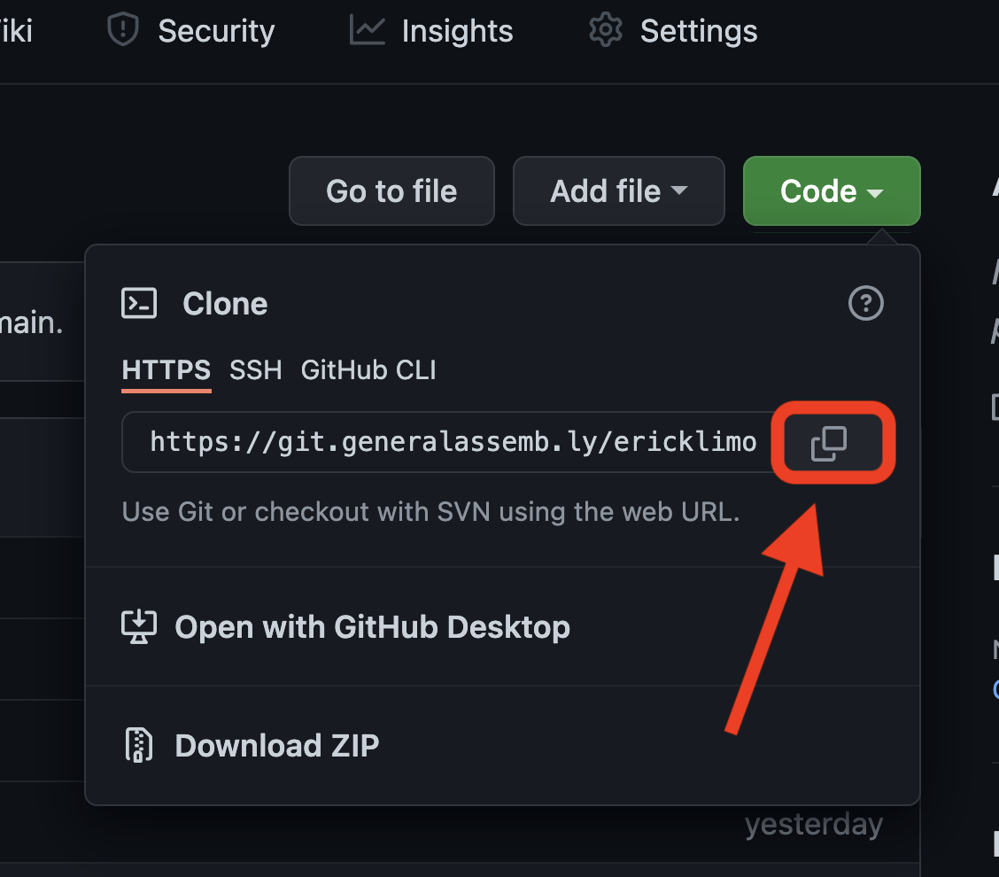
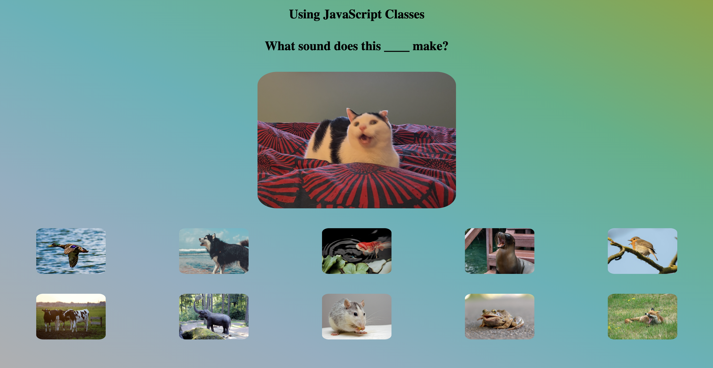

# ![[Using Classes] - Setup](./assets/hero.png)


Here’s the **[link to the repository we will be using for this lesson](https://git.generalassemb.ly/modular-curriculum-all-courses/using-classes-starter-code)**.

Click on the **`Fork`** button to create your own copy of the repo:



Once you have your own copy of the repo, you'll need to make a local repository on your machine. To get the link, click on the green **`Code`** button to open the dropdown:



Click the **`copy`** icon to store a copy of the link to your remote repo to your clipboard:



Open your Terminal application and navigate to your `~/code/ga/lectures` directory:

```bash
cd ~/code/ga/lectures
```

Clone a copy of your remote repo locally by using the `git clone` command, pasting the copied link to your repo:

```bash
git clone https://git.generalassemb.ly/<your-username>/using-classes-starter-code.git
```

> 📚 Note: In the link above, where it says `<your-username>`, you should see the username from your GitHub account.


Next, `cd` into your new cloned directory, `using-classes-starter-code`:

```bash
cd using-classes-starter-code
```

Open the project's folder in your code editor:

```bash
code .
```

Open your `index.html` file in the browser. You should see something like this:


